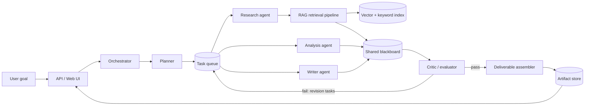
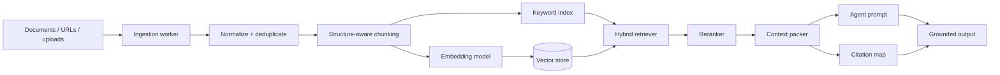

# Multi-Agent Workflow Architecture

## Product concept

Build **AgentVerse**, a goal-to-deliverable multi-agent workspace for autonomous startup and market due diligence: a user submits a company or idea, and a controller decomposes it into research, analysis, and memo-writing tasks before an evaluator checks and revises the investment recommendation.

The demo workflow is a **startup investment memo** covering competitors, market sizing, risks, financial assumptions, evidence, and recommended next steps.

## Architecture at a glance



## RAG pipeline

RAG is a first-class subsystem used by the researcher, analyst, writer, and critic. Agents retrieve grounded context from the indexed knowledge base instead of relying on private model memory.



### Ingestion and retrieval

The ingestion worker accepts web pages, PDFs, Markdown, text files, and user-provided URLs. It extracts readable content, normalizes headings/tables, deduplicates by content hash, chunks by semantic structure, preserves heading breadcrumbs, attaches source metadata, and writes both vector and keyword indexes.

At query time, the pipeline runs semantic and BM25 search, merges results with reciprocal-rank fusion, applies access/freshness filters, reranks the candidates, and packs only the most relevant diverse chunks into the agent context. Each result includes a stable `document_id`, `chunk_id`, source URL, and locator.

New sources discovered by the researcher must go through ingestion before other agents can cite them: **discover → ingest → retrieve → cite**.

### Grounding contract

```json
{
  "query": "criteria for comparing ...",
  "retrieved_chunks": [
    {"chunk_id": "chunk_abc", "source_url": "https://example.com", "locator": "page 4", "score": 0.91}
  ],
  "answer_claims": [
    {"claim": "...", "supported_by": ["chunk_abc"]}
  ]
}
```

The writer may only present factual claims with supporting chunk ids, or explicitly label them as analysis/inference. The critic checks citation coverage and whether cited chunks support the claims.

Add these entities to the shared state:

```text
Document(id, run_id, source_url, title, content_hash, metadata_json, ingested_at)
Chunk(id, document_id, ordinal, heading_path, text, token_count, metadata_json)
Embedding(chunk_id, model, vector_ref, created_at)
Retrieval(id, run_id, task_id, query, filters_json, created_at)
RetrievalHit(retrieval_id, chunk_id, rank, semantic_score, keyword_score, rerank_score)
ClaimSupport(claim_id, chunk_id, support_type, confidence)
```

## Core components

### 1. API and run workspace

Expose:

- `POST /runs` — create a run from a user goal and quality criteria.
- `GET /runs/:id` — return status, agent activity, evidence, and the latest artifact.
- `POST /runs/:id/approve` — optional human approval gate before expensive or external actions.
- `POST /runs/:id/cancel` — stop queued work safely.

The UI should show a run timeline, current tasks, agent outputs, citations/evidence, evaluator score, and the final artifact. This makes inter-agent collaboration visible to judges.

### 2. Orchestrator / controller

The controller owns the state machine, not the domain reasoning. It:

1. validates the goal and success criteria;
2. asks the planner for a typed task graph;
3. schedules tasks whose dependencies are satisfied;
4. routes each task to an agent profile;
5. persists every message and tool call;
6. retries transient failures with an idempotency key;
7. invokes the critic and either schedules revisions or finalizes the run.

Before specialist execution, it ensures the run's source set is indexed and records retrieval settings—top-k, filters, reranker, and embedding model—for reproducibility.

Use a state-machine loop rather than an unconstrained agent-to-agent chat. Every transition is persisted, inspectable, and replayable.

### 3. Specialist agents

Keep each agent narrow and give it the minimum tools needed.

| Agent | Responsibility | Allowed tools | Output |
|---|---|---|---|
| Planner | Convert goal into a dependency-aware task graph | none | `TaskPlan` |
| Researcher | Gather facts and source evidence through RAG | web/search, ingestion, retrieval | `EvidenceBundle` |
| Analyst | Compare retrieved evidence, calculate, identify trade-offs | code execution, retrieval, blackboard read | `AnalysisMemo` |
| Writer | Produce a citation-grounded artifact from approved context | retrieval, blackboard read/write | `DraftArtifact` |
| Critic | Score completeness, factual support, citation coverage, and format | retrieval, blackboard read | `Evaluation` |
| Reviser | Fix only failed criteria | blackboard read/write | `RevisionPatch` |

Each profile contains a system prompt, JSON schema, tool allowlist, token budget, timeout, and maximum retries. The agent never directly mutates another agent's output; it publishes a new version.

### 4. Shared blackboard / memory

Use a relational state store for run state plus a vector-and-keyword index for the RAG corpus. The retrieval interface must still support a local deterministic fallback for demos and tests.

Recommended entities:

```text
Run(id, goal, criteria_json, status, iteration, created_at)
Task(id, run_id, type, status, depends_on_json, assigned_agent, attempt)
Message(id, run_id, task_id, sender, recipient, schema_name, payload_json, created_at)
Evidence(id, run_id, source_url, claim, excerpt, hash, collected_by)
Document(id, run_id, source_url, title, content_hash, metadata_json, ingested_at)
Chunk(id, document_id, ordinal, heading_path, text, token_count, metadata_json)
Retrieval(id, run_id, task_id, query, filters_json, created_at)
RetrievalHit(retrieval_id, chunk_id, rank, semantic_score, keyword_score, rerank_score)
Artifact(id, run_id, version, kind, content, created_by, created_at)
Evaluation(id, run_id, artifact_version, score, passed, failures_json, created_at)
```

Treat the blackboard as append-only for messages, evidence, artifacts, and evaluations. Store a current projection for fast UI reads. This gives you auditability and makes the shared-memory pillar demonstrable.

### 5. Tool gateway

Agents call tools through one gateway that enforces:

- per-agent allowlists;
- timeouts and retries;
- URL/domain restrictions;
- request and response logging;
- secret isolation;
- cost and call budgets.

For the demo, implement two tools: `search_web` and `run_python`. Add a mock tool mode so the demo still works if an external API is unavailable.

## Communication contract

All agent handoffs use an envelope like this:

```json
{
  "run_id": "run_123",
  "task_id": "task_456",
  "message_type": "evidence_bundle",
  "schema_version": "1.0",
  "sender": "researcher",
  "recipient": "analyst",
  "payload": {
    "claims": [
      {
        "claim": "...",
        "source_url": "https://example.com",
        "confidence": 0.86,
        "supporting_excerpt": "..."
      }
    ],
    "open_questions": ["..."]
  }
}
```

The recipient must reject malformed payloads and report a structured error. Do not pass raw conversational transcripts as the primary protocol.

## Execution lifecycle

```text
RECEIVED
  -> PLANNING
  -> EXECUTING (parallel specialist tasks)
  -> DRAFTING
  -> EVALUATING
      -> REVISING -> EXECUTING / DRAFTING
      -> APPROVED -> COMPLETED
  -> FAILED or CANCELLED
```

Set a hard limit of three evaluator iterations. On failure, return the best artifact plus the failed criteria and evidence gaps instead of looping forever.

## Critic / self-improvement loop

The critic receives the original goal, success criteria, artifact, evidence index, and prior evaluation. It must return:

```json
{
  "passed": false,
  "score": 78,
  "criteria": [
    {"name": "source coverage", "score": 0.6, "passed": false, "feedback": "..."}
  ],
  "revision_tasks": [
    {"type": "research", "instruction": "Find a primary source for ...", "priority": "high"}
  ]
}
```

The controller converts `revision_tasks` into normal tasks. The critic cannot edit the artifact, and the writer cannot mark its own work as approved. This separation is the strongest proof of the bonus loop.

## Recommended implementation stack

For a fast, credible hackathon build:

- **Backend:** Python + FastAPI.
- **Orchestration:** a typed application state machine; use a queue abstraction, but avoid introducing a heavyweight workflow platform for the demo.
- **Validation:** Pydantic models for every handoff.
- **Storage:** SQLite for local demo, PostgreSQL-compatible schema for deployment.
- **Frontend:** React or a simple server-rendered UI with a live run timeline.
- **Model adapter:** one interface supporting the chosen LLM and a deterministic mock provider.
- **Deployment:** one API service plus one worker process and one database.

The important architectural choice is the contracts and persisted state, not the framework brand. Keep model access behind `LLMProvider.generate(structured_schema, messages)` so providers can be swapped without touching agents.

## MVP scope for the demo

1. User enters a startup/market due-diligence goal and three quality criteria.
2. Planner creates four tasks.
3. Researcher gathers 3–5 sources.
4. Analyst produces a comparison table.
5. Writer creates a Markdown report.
6. The report includes citations linked to retrieved chunks.
7. Critic checks artifact quality and RAG grounding, catching at least one missing requirement.
8. Reviser runs once and the second evaluation passes.
9. UI shows the event trail, retrieved evidence, and final report.

Do not start with multi-user auth, long-term memories, autonomous browsing across arbitrary sites, or many model providers. Those are post-demo extensions.

## Judge-facing proof points

Map the demo explicitly to the rubric:

- **Specialized agents:** profiles, separate prompts, and tool allowlists visible in the run detail.
- **Central orchestrator:** task graph and state transitions visible in the timeline.
- **Inter-agent communication:** typed envelopes and schema-validated messages.
- **Shared memory:** evidence and artifact versions on the blackboard.
- **RAG grounding:** indexed sources, retrieval traces, reranked context, and claim-to-chunk citations.
- **End-to-end execution:** a downloadable finished report, not only a plan.
- **Self-improvement:** failed evaluation creates revision tasks and a later passing score.

## Reliability and safety guardrails

- Every task has a timeout, retry limit, and idempotency key.
- Never expose secrets to prompts or persist raw secrets in logs.
- Attach source URLs and confidence to factual claims.
- Preserve chunk provenance and never cite a source that was not retrieved for the claim.
- Evaluate retrieval separately from generation: recall@k, citation coverage, and unsupported-claim rate.
- Mark unsupported claims as unresolved rather than allowing the writer to invent them.
- Keep external side effects behind explicit approval.
- Record model name, prompt version, tool calls, latency, and token/cost estimates.
- Redact or hash sensitive input before sending it to third-party model APIs.

## Suggested repository layout

```text
app/
  api.py
  models.py          # Pydantic contracts
  orchestrator.py    # state machine and scheduler
  rag/
    ingest.py
    chunking.py
    embeddings.py
    retriever.py
    reranker.py
    context.py
  agents/
    planner.py
    researcher.py
    analyst.py
    writer.py
    critic.py
  tools/
    gateway.py
    search.py
    python_runner.py
  storage/
    repository.py
  providers/
    llm.py
  ui/
tests/
  test_contracts.py
  test_revision_loop.py
  test_idempotency.py
```

## Build order

1. Define Pydantic contracts and a deterministic mock LLM.
2. Implement ingestion, structure-aware chunking, embeddings, and hybrid retrieval with a fixture corpus.
3. Implement the blackboard repository and event log, including retrieval traces.
4. Implement the orchestrator with a fixed task graph.
5. Add specialist prompts and retrieved-context injection.
6. Add search and Python tools behind the gateway; route discovered sources through ingestion.
7. Add the critic/revision loop with citation-grounding checks.
8. Build the timeline UI with an evidence/retrieval panel and demo scenario.
9. Add tests for retrieval quality, citation coverage, malformed messages, retries, duplicate events, and max-iteration termination.

